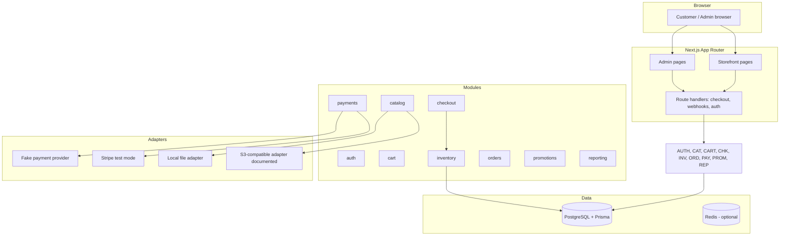

# Architecture

## 1. Stack

| Layer | Choice |
|-------|--------|
| Framework | Next.js App Router, React, TypeScript |
| Database | PostgreSQL |
| ORM | Prisma |
| Styling | Tailwind CSS (custom storefront/admin visual system) |
| Auth | Secure session-based authentication (HTTP-only cookies, role-based) |
| Payments | `PaymentProvider` interface: deterministic fake (dev/tests) + Stripe test-mode adapter |
| Background jobs | Redis/BullMQ only when reservations or jobs require it (documented placeholder in `workers/`) |
| File storage | Local storage adapter; documented S3-compatible adapter |
| Validation | Zod |
| Testing | Vitest, React Testing Library, Playwright |
| CI | GitHub Actions (no paid/external calls; Stripe mocked at network boundary) |
| Local dev | Docker Compose (PostgreSQL, optional Redis) |

## 2. Directory layout

```
src/
  app/                 storefront, account, admin route handlers
  modules/
    auth/              sessions, roles, authorization
    catalog/           categories, products, variants/SKUs, images
    cart/              guest and authenticated carts, merge on login
    checkout/          server pricing, idempotent checkout
    inventory/         ledger, reservations, expiry, availability
    orders/            order state machine, snapshots
    payments/          PaymentProvider interface, fake provider, Stripe adapter
    promotions/        discount codes, validation, rounding
    reporting/         summaries from real seed/order data
  components/          storefront and admin UI
  lib/                 prisma client, logging, validation, uploads
prisma/                schema and migrations
workers/               background job placeholders
tests/                 vitest, testing-library, playwright fixtures
docs/                  specifications and threat model
```

## 3. Component diagram (Mermaid)



## 4. Request flow — checkout (server-authoritative)

1. Customer submits checkout from the storefront.
2. Next.js route handler loads current product/SKU prices from the database (client-supplied amounts ignored).
3. Discount code validated server-side (window, subtotal, usage, scope).
4. Inventory availability checked inside a transaction; reservation created with expiry.
5. Payment session created via `PaymentProvider` with an idempotency key; `PaymentAttempt` recorded.
6. Client completes payment; provider notifies via webhook or return redirect.
7. Webhook signature verified; event ID checked for prior processing; order transitioned inside a transaction; reservation committed or released.
8. Order confirmation rendered; audit record written.

## 5. Trust boundaries

- Browser → server: all inputs untrusted (prices, quantities, discounts, redirect URLs).
- Server → database: single source of truth for prices and inventory.
- Stripe → server: webhooks rejected unless signature verifies and event ID unseen.
- Admin → server: role check + audit record on every mutating operation.