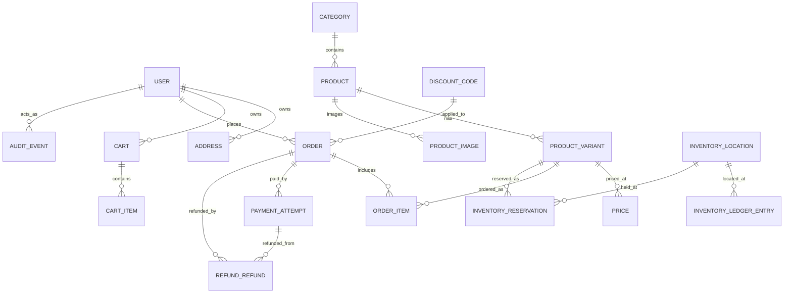

# Data model

## 1. Entities (minimum)

| Entity | Purpose |
|--------|---------|
| User | Customer or admin account; role (`customer`, `admin`) |
| Address | Shipping/billing address belonging to a user |
| Category | Product category tree |
| Product | Sellable item with name, description, media |
| ProductVariant / SKU | Purchasable variant with SKU code and price |
| ProductImage | Image tied to a product or variant |
| Price | Effective price for a SKU (supports future dated pricing) |
| InventoryLocation | Warehouse/bin where stock is held |
| InventoryLedgerEntry | Append-only record of every stock change (reason + actor) |
| InventoryReservation | Time-boxed stock hold for a pending checkout |
| Cart | Persistent cart (guest or authenticated) |
| CartItem | Line item in a cart |
| DiscountCode | Promotion: percentage/fixed, window, subtotal, usage, scope |
| Order | Order with explicit state machine and audit actor |
| OrderItem | Snapshot of name, SKU and price at purchase time |
| PaymentAttempt | Provider payment record with idempotency key |
| WebhookEvent | Received webhook event IDs for idempotent replay |
| RefundRecord | Refunds against a payment |
| AuditEvent | Who/what caused state changes, especially admin actions |

## 2. Entity-relationship diagram (Mermaid)



## 3. Commerce invariants (enforced in code and tests)

1. **Server pricing.** Product price is loaded on the server at checkout; client-calculated amounts, discounts or prices are never accepted.
2. **Order snapshots.** Order items snapshot product name, SKU and price at purchase time.
3. **Ledger-only inventory.** Every inventory change is an `InventoryLedgerEntry` with reason and actor; no unexplained direct counter edits.
4. **Transactions.** Inventory reservation and order creation run in a single database transaction.
5. **Idempotency.** Repeated checkout submissions and webhook replays produce the same outcome; webhook event IDs are stored and processed once.
6. **Signature verification.** Stripe webhooks are processed only after signature verification.
7. **Explicit transitions.** Order and payment status transitions are explicit, validated and recorded with the actor.
8. **Trusted redirects.** Redirect URLs come from server configuration only.
9. **Admin audit.** Every admin operation requires a centralized role check and an audit record.
10. **No negative stock.** Concurrent purchases cannot drive available inventory below zero (tested with two buyers for the final unit).

## 4. Order state machine

```
pending_payment → paid → processing → fulfilled
       ↓             ↓         ↓
     cancelled   cancelled  refunded/refunded
```

Invalid transitions are rejected; each transition records who/what caused it.

## 5. Notes

- All seed data is fictional and deterministic.
- Sensitive on-hand counts are not exposed on the storefront unless intentionally designed.